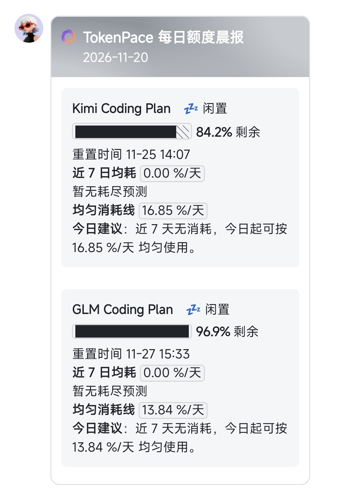

<div align="center">

# TokenPace

**Know your burn. Pace your tokens. Never run dry.**

Your AI token pacer — a zero-maintenance daily quota briefing with **zero runtime dependencies**.

[Quick Start](#quick-start) · [Why TokenPace?](#why-tokenpace) · [Configuration](#configuration) · [Pacing Rules](#pacing-rules) · [中文文档](README.zh-CN.md)

[](https://www.python.org/)
[](#why-tokenpace)
[](https://github.com/scchy/token-pace/actions/workflows/ci.yml)
[](https://github.com/scchy/token-pace/actions/workflows/morning-brief.yml)
[](LICENSE)
[](https://github.com/scchy/token-pace/stargazers)

</div>

---

TokenPace turns scattered AI balances into one actionable morning brief. It combines your remaining quota, actual seven-day burn rate, and cycle reset date to answer three questions at a glance:

1. **How much is left?**
2. **Will it last until the next reset?**
3. **How much can I safely use today?**

Get the answer where you already are: **Feishu, Telegram, or iOS Bark** — no dashboard, database, server, or always-on process.

<div align="center">

**[Use Template (Private)](https://github.com/scchy/token-pace/generate) · [Config-Only + uvx](examples/config-only-repo) · [Local Private Card](#option-b--local-private-card--cron) · [Agent Setup](#ai-assisted-setup)**

</div>

## AI-Assisted Setup

Open your fork or clone with a coding agent and say:

> Configure TokenPace for me using the project skill. Ask which plans and notifiers I need, create plans.toml, and validate it with a dry run.

[AGENTS.md](AGENTS.md) and the [`tokenpace-setup`](.agents/skills/tokenpace-setup/SKILL.md) skill guide minimal configuration, credential safety, dry-run validation, and optional scheduling — without asking for secrets in chat. No MCP server is required: agents can call the CLI directly, while scheduled delivery remains push-based.

## Morning Brief

<div align="center">
  <br>
  <sub>Actual Feishu Card 2.0: full-width plan groups, compact progress bars, and minute-level rolling reset times.</sub>
</div>

## Why TokenPace?

| Capability | What it means for you |
| --- | --- |
| **Actionable, not just informational** | See your burn rate, predicted exhaustion date, sustainable pace, and a concrete daily budget. |
| **One brief for every plan** | Aggregate official APIs, custom JSON endpoints, and local Coding Agent logs. |
| **Reliable seven-day history** | Same-day runs are idempotent, missed days are smoothed, and cycle resets are detected automatically. |
| **Failure isolation** | One unavailable provider does not block the rest of your briefing; errors are clearly appended. |
| **Private by default** | Credentials come from environment variables. Your ledger stays in your own repository or machine. |
| **Simple to audit and run** | Python 3.11+ standard library only, plain JSONL storage, and no runtime packages to install. |

## Quick Start

### Option A — GitHub Actions (Recommended)

**This is the reference deployment**: zero server maintenance, daily execution at **08:30 Asia/Shanghai**, and automatic ledger commits. Use it unless you need local logs or `lark-cli` direct messages.

1. Click **[Use this template](https://github.com/scchy/token-pace/generate)** and create a **Private** repository. GitHub does not allow changing a public fork to private; a private template copy keeps your usage history private.
2. Copy `plans.example.toml` to `plans.toml`, remove unused plans and notifiers, then commit it.
3. Add the referenced credentials under **Settings → Secrets and variables → Actions**. The workflow already maps OpenRouter, DeepSeek, Kimi (`KIM_CODE_API_KEY`), GLM (`GLM_TOKEN_PLAN_API_KEY`), Feishu, Telegram, and Bark.
4. Open **Actions → TokenPace Morning Brief → Run workflow** to send your first brief. New snapshots are committed to `data/ledger.jsonl` automatically.

**Maintainer note:** the `/generate` link requires **Settings → General → Template repository** to be enabled on the upstream repository.

#### Alternative: config-only private repository with `uvx`

For a minimal personal deployment, create a Private repository containing only `plans.toml` and `.github/workflows/morning-brief.yml`, using [`examples/config-only-repo`](examples/config-only-repo). Its workflow runs `uvx --from git+https://github.com/scchy/token-pace.git`, so upstream fixes arrive without syncing source code, while the ledger remains private. To make runs reproducible, pin the source to a release such as `git+https://github.com/scchy/token-pace.git@v0.1.0`.

> GitHub schedules may be delayed by several minutes. Use local mode for `local_jsonl` sources on your machine. Keep direct pushes enabled on the ledger branch or adapt the persistence step for your branch protection rules.

### Option B — Local Private Card / Cron

For a personal setup, `feishu_cli` sends a **Card 2.0 directly to you** — no group and no webhook required. Python 3.11+ and [uv](https://docs.astral.sh/uv/) are required.

1. Copy `plans.example.toml` to `plans.toml` and keep only your plans. For Feishu, select `type = "feishu_cli"`.
2. Set provider credentials in your own shell and verify `lark-cli auth status --json --verify`. Do not put secrets in `plans.toml`.
3. Preview, then explicitly run the real delivery:

```bash
# Fetch real quotas; no ledger write and no notification
uv run tokenpace --config plans.toml --dry-run

# Write snapshots and send a private Card 2.0
uv run tokenpace --config plans.toml
```

If credentials are exported from `.bashrc`, use `bash -ic 'uv run tokenpace --config plans.toml'` for the same behavior in a non-interactive agent or cron shell.

```cron
30 8 * * * cd ~/token-pace && bash -ic 'uv run tokenpace --config plans.toml' >> /tmp/token-pace.log 2>&1
```

Cron does not inherit your interactive shell automatically. Verify every required variable and `lark-cli` authentication in the cron environment before relying on the schedule. You can also invoke `uv run token-pace` or `uv run python -m tokenpace`.

## How It Works

```text
Providers → Append-only JSONL Ledger → Pacing Engine → Feishu / Telegram / Bark
```

For every plan, TokenPace calculates:

- **Remaining quota**: `R = max(0, Q - U)`
- **Sustainable daily pace**: `safe = R / max(1, D)`
- **Seven-day burn rate**: the arithmetic mean of up to seven real daily increments
- **Pacing ratio**: `ρ = B / safe`
- **Estimated exhaustion**: `R / B`, when usage is greater than zero

Enable `workdays_only` to distribute the remaining quota across weekdays only.

## Configuration

Credentials must use `${ENV_VAR}` placeholders. TokenPace stops with a clear error if a referenced variable is missing.

A minimal configuration looks like this:

```toml
[general]
locale = "en"
timezone = "Asia/Shanghai"
ledger_path = "data/ledger.jsonl"
workdays_only = false
timeout = 10

[[plans]]
id = "openrouter"
name = "OpenRouter API"
provider = "openrouter"
unit = "USD"
total_quota = 100.0
reset_cycle = "monthly:1"
[plans.auth]
api_key = "${OPENROUTER_API_KEY}"

[[notifiers]]
type = "feishu_cli"
identity = "bot"
```

For a team group or GitHub Actions, replace the notifier with `type = "feishu"` and `webhook_url = "${FEISHU_WEBHOOK_URL}"`.

Relative ledger paths are resolved from the configuration file. Reset cycles support:

| Format | Behavior |
| --- | --- |
| `monthly:N` | Reset on day N each month; shorter months use their last day |
| `YYYY-MM-DD` | Use a fixed reset date |

`locale` accepts `en` or `zh` and controls briefing titles, statuses, and advice. It defaults to `zh` for backward compatibility; the English examples select `en`.

See [`plans.example.toml`](plans.example.toml) for a complete multi-provider setup.

### Providers

| Provider | Source | Key configuration |
| --- | --- | --- |
| `openrouter` | OpenRouter key API, reading `data.usage` | `plans.auth.api_key` |
| `deepseek` | DeepSeek balance API, converted to usage | `plans.auth.api_key` |
| `http_json` | Any GET JSON endpoint | `url`, `value_path`, `scale`, `mode`, custom headers |
| `local_jsonl` | Local Coding Agent / CLI JSONL logs | `log_glob`, field mapping, scale, aggregation |

**OpenRouter usage is cumulative for the lifetime of the API key.** Set `total_quota` to that key's lifetime budget, or use a key with its own reset cycle. Setting `monthly:1` in TokenPace does not reset OpenRouter's reported `data.usage`.

`http_json.value_path` supports nested objects and array indexes, such as `data.items.0.remaining`. Set `mode = "used"` for consumed quota or `"remaining"` for remaining quota. For rolling quotas, set `options.reset_path` to an ISO timestamp, date, or Unix timestamp in the response; the next reset date then follows the provider instead of a fixed weekday, with timestamps displayed to the minute.

<details>
<summary><strong>Verified Kimi and GLM rolling-quota recipes</strong></summary>

Both examples use percentage pacing and response-driven reset times. `reset_cycle` is only a static placeholder; `reset_path` wins on every fetch.

```toml
[[plans]]
id = "kimi-code"
name = "Kimi Coding Plan"
provider = "http_json"
unit = "%"
total_quota = 100.0
reset_cycle = "2026-11-25"
[plans.options]
url = "https://api.kimi.com/coding/v1/usages"
value_path = "usages.limit_7d.used_ratio"
reset_path = "usages.limit_7d.reset_time"
scale = 100
mode = "used"
[plans.headers]
Authorization = "Bearer ${KIM_CODE_API_KEY}"

[[plans]]
id = "glm-code"
name = "GLM Coding Plan"
provider = "http_json"
unit = "%"
total_quota = 100.0
reset_cycle = "2026-11-27"
[plans.options]
url = "https://open.bigmodel.cn/api/monitor/usage/quota/limit"
value_path = "data.limits.1.currentValue"
reset_path = "data.limits.1.nextResetTime"
scale = 0.0007142857142857143 # 100 / 140000
mode = "used"
[plans.headers]
Authorization = "${GLM_TOKEN_PLAN_API_KEY}" # raw key, no Bearer
```

For GLM, verify that the selected entry is the weekly window (`unit = 6`) and replace `140000` in the scale formula with its `usage` cap. Do not assume the same array position for every account. When changing a plan's unit, migrate its historical ledger values to the same unit to avoid a false reset.

</details>

<details>
<summary><strong>DeepSeek and custom HTTP JSON examples</strong></summary>

```toml
[[plans]]
id = "deepseek"
name = "DeepSeek API"
provider = "deepseek"
unit = "CNY"
total_quota = 200.0
reset_cycle = "monthly:1"
[plans.auth]
api_key = "${DEEPSEEK_API_KEY}"

[[plans]]
id = "custom-plan"
name = "My Coding Plan"
provider = "http_json"
unit = "M tokens"
total_quota = 50.0
reset_cycle = "monthly:15"
[plans.options]
url = "https://api.example.com/v1/usage"
value_path = "data.used_tokens"
scale = 1e-6
mode = "used"
[plans.headers]
Authorization = "Bearer ${CUSTOM_PLAN_TOKEN}"
```

</details>

<details>
<summary><strong>Local JSONL provider example</strong></summary>

```toml
[[plans]]
id = "local-agent"
name = "Local Coding Agent"
provider = "local_jsonl"
unit = "M tokens"
total_quota = 50.0
reset_cycle = "monthly:1"
[plans.options]
log_glob = "~/.coding-agent/usage/**/*.jsonl"
value_path = "usage.total_tokens"
timestamp_path = "timestamp"
scale = 1e-6
aggregate = "sum" # sum records, or use latest for a cumulative field
```

For monthly plans, timestamped records are limited to the current cycle; records without timestamps are included. ISO timestamps, dates, Unix seconds, and milliseconds are supported.

When `value_path` is omitted, TokenPace checks `usage.total_tokens`, `total_tokens`, `tokens`, `used`, and `cost` in order. Cost-based logs can therefore be normalized into a monetary unit too.

</details>

### Notifiers

| Notifier | Delivery style | Required settings |
| --- | --- | --- |
| `feishu` | Interactive Card with progress bars and status colors | `webhook_url` |
| `feishu_app` | Card 2.0 direct message through the Feishu app API | `app_id`, `app_secret`, `user_id`; optional `base_url` |
| `feishu_cli` | Card 2.0 direct message through local `lark-cli` | Local CLI login; optional `user_id`, `identity`, `cli_path` |
| `telegram` | MarkdownV2 message | `bot_token`, `chat_id` |
| `bark` | iOS push notification | `device_key`; optional `server`, `group`, `icon` |

For **private direct messages in GitHub Actions**, use `feishu_app`. Store `FEISHU_APP_ID`, `FEISHU_APP_SECRET`, and `FEISHU_USER_ID` (the recipient's open_id) as Actions Secrets. The app needs the bot send-message scope and a direct-message relationship with the recipient; no group is required.

```toml
[[notifiers]]
type = "feishu_app"
app_id = "${FEISHU_APP_ID}"
app_secret = "${FEISHU_APP_SECRET}"
user_id = "${FEISHU_USER_ID}"
```

`feishu_cli` is the simplest option for a personal local setup. It sends a Card 2.0 to the current CLI user by default, without storing an App Secret in `plans.toml`. Each plan uses a full-width group with a compact nine-cell progress bar; percentage plans omit the redundant `85 / 100 %` denominator, and rolling resets are shown to the minute. The app bot needs the send-message scope and a direct-message relationship with the recipient. Use `user_id = "ou_xxx"` to override the recipient or `identity = "user"` to send as the authorized user.

TokenPace's `--dry-run` never calls a notifier. To inspect the Feishu request separately, run `lark-cli im +messages-send ... --dry-run`; only a normal TokenPace run writes the ledger and sends the card.

```toml
[[notifiers]]
type = "feishu_cli"
identity = "bot"
# user_id = "ou_xxx" # optional; defaults to the current CLI user

[[notifiers]]
type = "telegram"
bot_token = "${TELEGRAM_BOT_TOKEN}"
chat_id = "${TELEGRAM_CHAT_ID}"

[[notifiers]]
type = "bark"
device_key = "${BARK_DEVICE_KEY}"
server = "https://api.day.app"
group = "TokenPace"
```

## Pacing Rules

| Status | Condition | Recommended action |
| --- | --- | --- |
| 🚨 Exhausted | `R = 0` | Switch to a backup provider or wait for reset |
| ⚠️ Fast | `ρ > 1.2` | Stay within the sustainable pace; use lighter models for routine tasks |
| ✅ Healthy | `0.8 ≤ ρ ≤ 1.2` | Maintain the current pace |
| 🟢 Surplus | `0 < ρ < 0.8` | Move long-context or reasoning-heavy tasks forward |
| 💤 Idle | `B = 0` | Start from the suggested daily budget |

Missing days are averaged across the snapshot interval. A decrease in cumulative usage is treated as a cycle reset. New plans use the available samples rather than padding missing history with zeros.

## Development

```bash
uv run pytest
uv run tokenpace --help
```

The extension surface is intentionally small:

- **Provider**: implement `Provider.fetch()` and register it in `src/tokenpace/providers/__init__.py`.
- **Notifier**: implement `Notifier.send()` and register it in `src/tokenpace/notifiers/__init__.py`.

Every push and pull request runs the full test suite through [CI](.github/workflows/ci.yml). Notifier tests use local mocks and require no credentials.

## Roadmap

| Planned addition | Contribution welcome |
| --- | --- |
| Discord notifier | PR welcome |
| Slack notifier | PR welcome |
| Generic JSON webhook notifier | PR welcome |
| More provider presets, including Kimi, Anthropic, and Zhipu | PR welcome |

## Star History

<div align="center">

[](https://star-history.com/#scchy/token-pace&Date)

</div>

---

<div align="center">

**[MIT License](LICENSE)** · Built for developers who want to spend tokens wisely.

</div>
