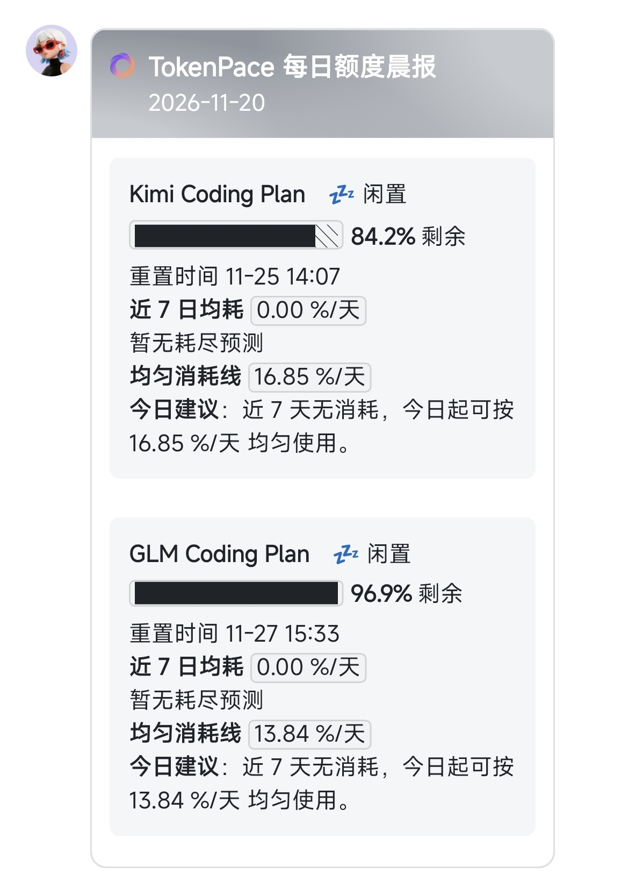

<div align="center">

# TokenPace

**看清消耗，配好节奏，让每一份额度物尽其用。**

你的 AI Token 配速员 —— 零运维、**零运行时依赖**的每日额度晨报工具。

[快速开始](#快速开始) · [核心特性](#核心特性) · [配置](#配置) · [配速规则](#配速规则) · [English](README.md)

[](https://www.python.org/)
[](#核心特性)
[](https://github.com/scchy/token-pace/actions/workflows/ci.yml)
[](https://github.com/scchy/token-pace/actions/workflows/morning-brief.yml)
[](LICENSE)
[](https://github.com/scchy/token-pace/stargazers)

</div>

---

TokenPace 将分散在各个平台的 AI 额度汇总成一份可以直接指导行动的晨报，结合剩余额度、近 7 日真实消耗速率和周期重置日，让你一眼看懂：

1. **还剩多少额度？**
2. **按当前速度能否坚持到重置？**
3. **今天用多少最合适？**

晨报直接推送到你已经在看的 **飞书、Telegram 或 iOS Bark**，无需仪表盘、数据库、服务器或常驻进程。

<div align="center">

**[使用模板创建私有仓库](https://github.com/scchy/token-pace/generate) · [极简配置仓 + uvx](examples/config-only-repo) · [本地私聊卡片](#方式二本地私聊卡片--cron) · [Agent 配置](#让-ai-agent-帮你配置)**

</div>

## 让 AI Agent 帮你配置

使用 Coding Agent 打开你的 Fork 或本地 clone，然后对它说：

> 使用项目里的 skill 帮我配置 TokenPace。询问我需要监控的套餐和通知渠道，创建 plans.toml，并通过 dry run 验证。

[AGENTS.md](AGENTS.md) 和 [`tokenpace-setup`](.agents/skills/tokenpace-setup/SKILL.md) skill 会引导 Agent 生成最小配置、保护凭证、执行 dry-run，并按需设置定时任务，无需在聊天中提供密钥。无需额外部署 MCP：Agent 可直接调用 CLI，定时晨报仍采用主动推送模式。

## 晨报预览

<div align="center">
  <br>
  <sub>真实飞书 Card 2.0：全宽套餐分组、紧凑进度条、分钟级滚动重置时间。</sub>
</div>

## 核心特性

| 能力 | 带给你的价值 |
| --- | --- |
| **给决策，不只给数字** | 同时展示消耗速率、预计耗尽日、均匀消耗线和今日建议预算。 |
| **一份晨报汇总所有套餐** | 支持官方 API、自定义 JSON 接口和本机 Coding Agent 日志。 |
| **可靠的七日历史** | 同日运行幂等、缺失天数自动均摊、跨周期重置自动识别。 |
| **单点故障隔离** | 一个平台超时不会阻塞其他套餐，错误会清晰附在晨报末尾。 |
| **默认保护隐私** | 凭证只从环境变量读取，账本只保存在你的仓库或本机。 |
| **简单、透明、易审计** | 仅使用 Python 3.11+ 标准库，纯 JSONL 存储，无运行时第三方包。 |

## 快速开始

### 方式一：GitHub Actions（推荐）

**这是项目的标准示范部署**：零服务器运维，每天北京时间 **08:30** 自动运行并提交账本。除非需要本机日志或 `lark-cli` 私聊，否则优先使用此方式。

1. 点击 **[Use this template](https://github.com/scchy/token-pace/generate)** 创建 **Private（私有）仓库**。GitHub 不允许将公开仓库的 Fork 转为私有，使用模板可直接保护历史账本与使用习惯。
2. 复制 `plans.example.toml` 为 `plans.toml`，删除不需要的套餐和通知渠道，然后提交。
3. 在 **Settings → Secrets and variables → Actions** 添加配置引用的密钥。工作流已内置 OpenRouter、DeepSeek、Kimi（`KIM_CODE_API_KEY`）、GLM（`GLM_TOKEN_PLAN_API_KEY`）、飞书、Telegram 和 Bark 映射。
4. 打开 **Actions → TokenPace Morning Brief → Run workflow** 发送第一条晨报，新快照会自动提交到 `data/ledger.jsonl`。

**维护者提示：**`/generate` 入口需要先在主仓库的 **Settings → General → Template repository** 中启用。

#### 备选：极简私有配置仓 + `uvx`

个人自用时，可创建只包含 `plans.toml` 和 `.github/workflows/morning-brief.yml` 的私有仓库，直接复制 [`examples/config-only-repo`](examples/config-only-repo)。工作流通过 `uvx --from git+https://github.com/scchy/token-pace.git` 运行主仓代码，无需手动同步源码，账本仍留在私有仓库。需要可复现版本时，可固定为 `git+https://github.com/scchy/token-pace.git@v0.1.0`。

> GitHub 定时任务可能延迟数分钟。本机 `local_jsonl` 日志请使用本地运行方式。账本分支若启用禁止直接 push 的保护规则，需要相应调整自动提交步骤。

### 方式二：本地私聊卡片 / Cron

个人使用推荐 `feishu_cli`：**Card 2.0 直接私聊你**，不需要群聊或 Webhook。需要 Python 3.11+ 和 [uv](https://docs.astral.sh/uv/)。

1. 复制 `plans.example.toml` 为 `plans.toml`，只保留实际套餐；飞书选择 `type = "feishu_cli"`。
2. 在自己的 shell 中设置平台密钥，并通过 `lark-cli auth status --json --verify` 检查登录。不要把密钥写进 `plans.toml`。
3. 先预览，再明确执行真实发送：

```bash
# 拉取真实额度；不写账本、不发通知
uv run tokenpace --config plans.toml --dry-run

# 写入快照并私聊发送 Card 2.0
uv run tokenpace --config plans.toml
```

如果密钥配置在 `.bashrc`，在 Agent 或 cron 的非交互环境中可使用 `bash -ic 'uv run tokenpace --config plans.toml'`。

```cron
30 8 * * * cd ~/token-pace && bash -ic 'uv run tokenpace --config plans.toml' >> /tmp/token-pace.log 2>&1
```

cron 不会自动继承交互式 shell 环境。启用前请逐一确认所需环境变量和 `lark-cli` 登录态在 cron 中可用。也支持 `uv run token-pace` 和 `uv run python -m tokenpace`。

## 工作原理

```text
数据源 Providers → 追加式 JSONL 账本 → 配速引擎 → 飞书 / Telegram / Bark
```

TokenPace 为每个套餐计算：

- **当前剩余额度**：`R = max(0, Q - U)`
- **均匀消耗线**：`safe = R / max(1, D)`
- **近 7 日均耗**：最近最多 7 个真实日增量的算术平均
- **消耗水位比**：`ρ = B / safe`
- **预计耗尽天数**：有消耗时为 `R / B`

开启 `workdays_only` 后，均匀消耗线仅按剩余工作日计算。

## 配置

所有凭证必须使用 `${ENV_VAR}` 占位符。引用的环境变量缺失时，程序会给出明确错误。

最小配置示例：

```toml
[general]
locale = "zh"
timezone = "Asia/Shanghai"
ledger_path = "data/ledger.jsonl"
workdays_only = false
timeout = 10

[[plans]]
id = "openrouter"
name = "OpenRouter API"
provider = "openrouter"
unit = "USD"
total_quota = 100.0
reset_cycle = "monthly:1"
[plans.auth]
api_key = "${OPENROUTER_API_KEY}"

[[notifiers]]
type = "feishu_cli"
identity = "bot"
```

团队群聊或 GitHub Actions 可改用 `type = "feishu"` 和 `webhook_url = "${FEISHU_WEBHOOK_URL}"`。

相对账本路径以配置文件所在目录为基准。重置周期支持：

| 格式 | 行为 |
| --- | --- |
| `monthly:N` | 每月 N 日重置；小月份自动使用该月最后一天 |
| `YYYY-MM-DD` | 使用固定重置日期 |

`locale` 支持 `en` 和 `zh`，控制晨报标题、状态与建议文案。为兼容已有配置，默认值为 `zh`；英文示例显式使用 `en`。

完整多平台配置见 [`plans.example.toml`](plans.example.toml)。

### 数据源

| Provider | 数据来源 | 关键配置 |
| --- | --- | --- |
| `openrouter` | OpenRouter Key API，读取 `data.usage` | `plans.auth.api_key` |
| `deepseek` | DeepSeek 余额 API，换算为已用量 | `plans.auth.api_key` |
| `http_json` | 任意 GET JSON 接口 | `url`、`value_path`、`scale`、`mode`、自定义 Header |
| `local_jsonl` | 本机 Coding Agent / CLI JSONL 日志 | `log_glob`、字段映射、换算系数、聚合方式 |

**OpenRouter 的 `data.usage` 是 API Key 的历史累计用量。** `total_quota` 应填写该 Key 的总预算，或配合自身带重置周期的 Key 使用；仅在 TokenPace 中设置 `monthly:1` 不会让 OpenRouter 的累计用量归零。

`http_json.value_path` 支持嵌套对象和数组下标，例如 `data.items.0.remaining`。字段表示已用量时设置 `mode = "used"`，表示剩余量时设置为 `"remaining"`。滚动额度可设置 `options.reset_path`，指向响应中的 ISO 时间、日期或 Unix 时间戳，下一次重置日将自动跟随接口返回，而不是固定在某个星期几；时间戳会精确到分钟显示。

<details>
<summary><strong>已验证的 Kimi 与 GLM 滚动额度配方</strong></summary>

两个示例都按百分比配速，并跟随接口返回的重置时间。`reset_cycle` 只是静态占位，每次拉取均以 `reset_path` 为准。

```toml
[[plans]]
id = "kimi-code"
name = "Kimi Coding Plan"
provider = "http_json"
unit = "%"
total_quota = 100.0
reset_cycle = "2026-11-25"
[plans.options]
url = "https://api.kimi.com/coding/v1/usages"
value_path = "usages.limit_7d.used_ratio"
reset_path = "usages.limit_7d.reset_time"
scale = 100
mode = "used"
[plans.headers]
Authorization = "Bearer ${KIM_CODE_API_KEY}"

[[plans]]
id = "glm-code"
name = "GLM Coding Plan"
provider = "http_json"
unit = "%"
total_quota = 100.0
reset_cycle = "2026-11-27"
[plans.options]
url = "https://open.bigmodel.cn/api/monitor/usage/quota/limit"
value_path = "data.limits.1.currentValue"
reset_path = "data.limits.1.nextResetTime"
scale = 0.0007142857142857143 # 100 / 140000
mode = "used"
[plans.headers]
Authorization = "${GLM_TOKEN_PLAN_API_KEY}" # 原始 Key，不加 Bearer
```

GLM 请确认选中的条目是周窗口（`unit = 6`），并将换算公式中的 `140000` 替换为该条目的 `usage` 上限。不要假设所有账号的数组顺序一致。修改套餐单位时，也要同步换算历史账本，避免被误判为周期重置。

</details>

<details>
<summary><strong>DeepSeek 与自定义 HTTP JSON 示例</strong></summary>

```toml
[[plans]]
id = "deepseek"
name = "DeepSeek API"
provider = "deepseek"
unit = "CNY"
total_quota = 200.0
reset_cycle = "monthly:1"
[plans.auth]
api_key = "${DEEPSEEK_API_KEY}"

[[plans]]
id = "custom-plan"
name = "My Coding Plan"
provider = "http_json"
unit = "M tokens"
total_quota = 50.0
reset_cycle = "monthly:15"
[plans.options]
url = "https://api.example.com/v1/usage"
value_path = "data.used_tokens"
scale = 1e-6
mode = "used"
[plans.headers]
Authorization = "Bearer ${CUSTOM_PLAN_TOKEN}"
```

</details>

<details>
<summary><strong>本机 JSONL 数据源示例</strong></summary>

```toml
[[plans]]
id = "local-agent"
name = "Local Coding Agent"
provider = "local_jsonl"
unit = "M tokens"
total_quota = 50.0
reset_cycle = "monthly:1"
[plans.options]
log_glob = "~/.coding-agent/usage/**/*.jsonl"
value_path = "usage.total_tokens"
timestamp_path = "timestamp"
scale = 1e-6
aggregate = "sum" # 逐条累加；累计字段可改为 latest
```

月度套餐只统计当前周期内带时间戳的记录；无时间戳的记录会纳入统计。支持 ISO 时间、日期、Unix 秒和毫秒。

省略 `value_path` 时，依次识别 `usage.total_tokens`、`total_tokens`、`tokens`、`used`、`cost`。因此，成本日志也能统一换算为货币单位。

</details>

### 通知渠道

| Notifier | 推送样式 | 必需配置 |
| --- | --- | --- |
| `feishu` | 带进度条和状态色的 Interactive Card | `webhook_url` |
| `feishu_app` | 通过飞书应用 API 私聊 Card 2.0 | `app_id`、`app_secret`、`user_id`；可选 `base_url` |
| `feishu_cli` | 通过本机 `lark-cli` 私聊 Card 2.0 卡片 | 本机 CLI 登录态；可选 `user_id`、`identity`、`cli_path` |
| `telegram` | MarkdownV2 消息 | `bot_token`、`chat_id` |
| `bark` | iOS 推送通知 | `device_key`；可选 `server`、`group`、`icon` |

在 **GitHub Actions 中私聊个人**时，使用 `feishu_app`。将 `FEISHU_APP_ID`、`FEISHU_APP_SECRET` 和 `FEISHU_USER_ID`（接收人的 open_id）保存为 Actions Secrets。应用需要 Bot 发消息权限，并已和接收人建立私聊关系，不需要创建群。

```toml
[[notifiers]]
type = "feishu_app"
app_id = "${FEISHU_APP_ID}"
app_secret = "${FEISHU_APP_SECRET}"
user_id = "${FEISHU_USER_ID}"
```

本机个人使用推荐 `feishu_cli`：默认向当前 CLI 用户私聊 Card 2.0，无需在 `plans.toml` 保存 App Secret。每个套餐采用全宽分组和 9 格紧凑进度条；百分比套餐隐藏 `85 / 100 %` 冗余分母，滚动重置时间精确到分钟。应用 Bot 需要发消息权限，并与接收人建立私聊关系。可通过 `user_id = "ou_xxx"` 指定其他接收人，或用 `identity = "user"` 改为用户身份发送。

TokenPace 的 `--dry-run` 不会调用任何通知端。如需单独检查飞书请求，可执行 `lark-cli im +messages-send ... --dry-run`；只有正式运行 TokenPace 才会写账本并发送卡片。

```toml
[[notifiers]]
type = "feishu_cli"
identity = "bot"
# user_id = "ou_xxx" # 可选，默认当前 CLI 用户

[[notifiers]]
type = "telegram"
bot_token = "${TELEGRAM_BOT_TOKEN}"
chat_id = "${TELEGRAM_CHAT_ID}"

[[notifiers]]
type = "bark"
device_key = "${BARK_DEVICE_KEY}"
server = "https://api.day.app"
group = "TokenPace"
```

## 配速规则

| 状态 | 条件 | 今日建议 |
| --- | --- | --- |
| 🚨 耗尽 | `R = 0` | 切换备用通道或等待重置 |
| ⚠️ 偏快 | `ρ > 1.2` | 控制在均匀消耗线内，常规任务可切轻量模型 |
| ✅ 健康 | `0.8 ≤ ρ ≤ 1.2` | 维持当前频率 |
| 🟢 充裕 | `0 < ρ < 0.8` | 将长上下文或重度推理任务往前排 |
| 💤 闲置 | `B = 0` | 从建议的今日预算开始使用 |

相邻快照相隔多天时，消耗会均摊到区间每一天；累计用量回落时识别为周期重置。新套餐按实际样本数计算，不会用零填充缺失历史。

## 开发与测试

```bash
uv run pytest
uv run tokenpace --help
```

扩展接口保持极简：

- **数据源**：实现 `Provider.fetch()`，并在 `src/tokenpace/providers/__init__.py` 注册。
- **通知渠道**：实现 `Notifier.send()`，并在 `src/tokenpace/notifiers/__init__.py` 注册。

每次 push 和 Pull Request 都会通过 [CI](.github/workflows/ci.yml) 运行完整测试。通知端测试全部使用本地 Mock，不需要任何凭证。

## Roadmap

| 计划新增 | 社区贡献 |
| --- | --- |
| Discord 通知渠道 | 欢迎 PR |
| Slack 通知渠道 | 欢迎 PR |
| 通用 JSON Webhook 通知渠道 | 欢迎 PR |
| Kimi、Anthropic、智谱等更多 Provider 预设 | 欢迎 PR |

## Star History

<div align="center">

[](https://star-history.com/#scchy/token-pace&Date)

</div>

---

<div align="center">

**[MIT License](LICENSE)** · 为希望把每一份 Token 都用在刀刃上的开发者而构建。

</div>
